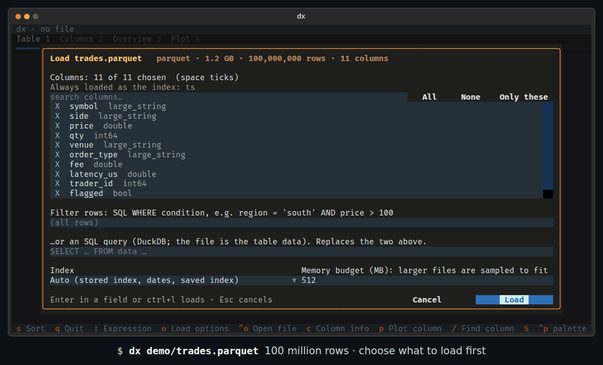
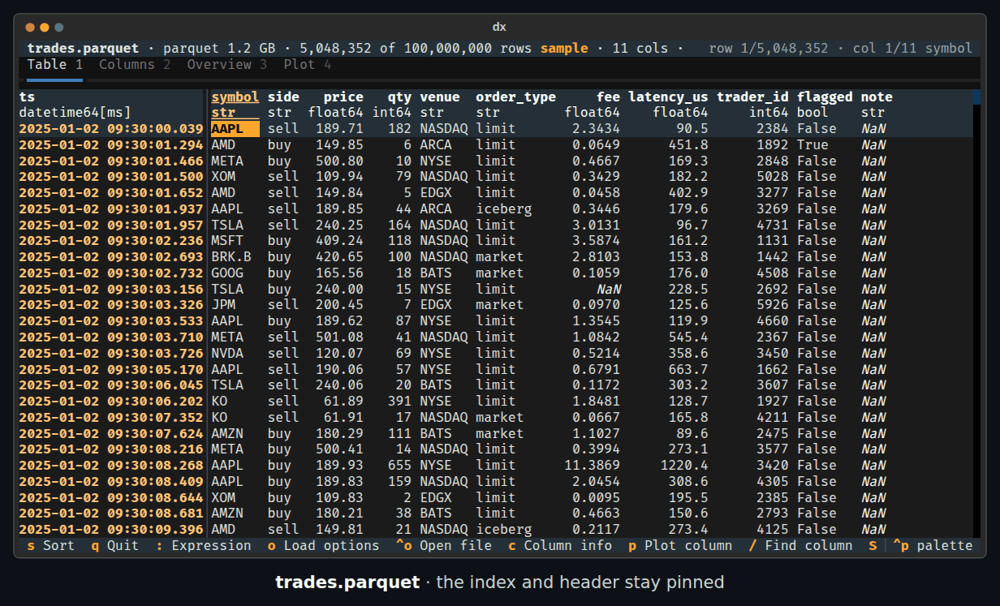
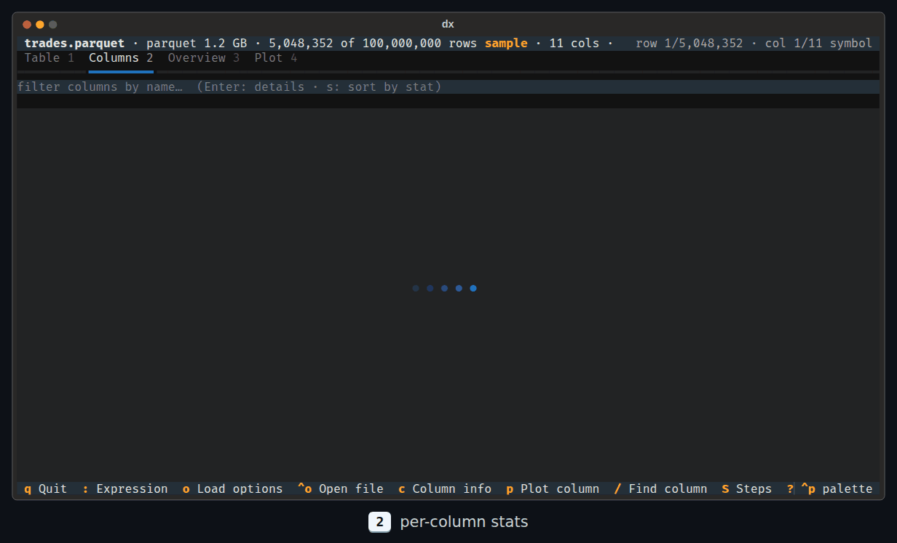
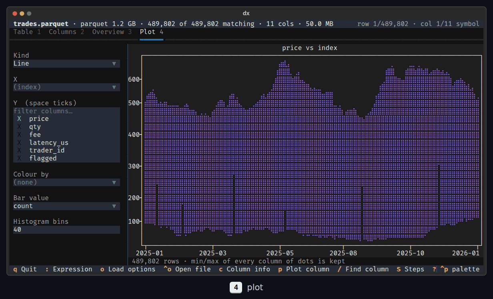
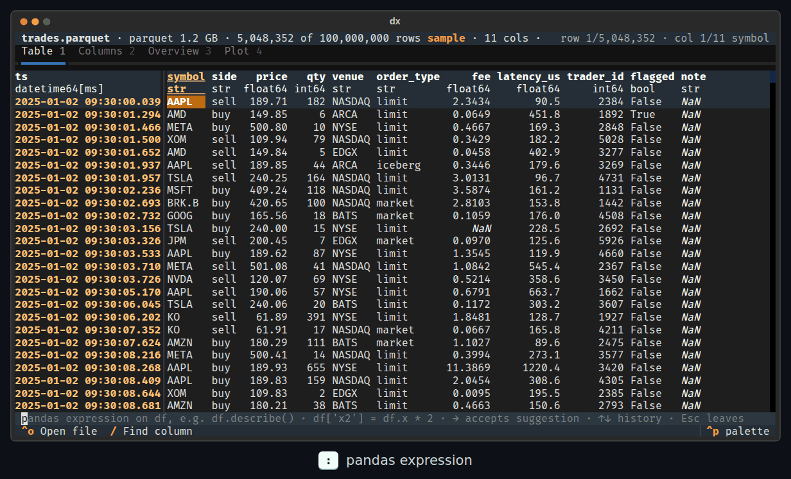
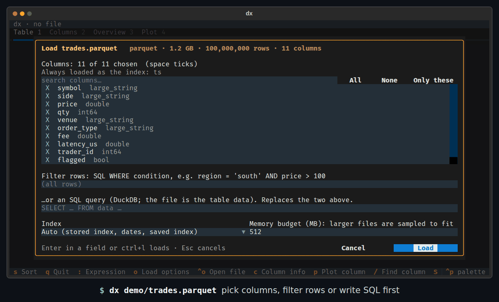

<div align="center">

# dx

**Explore any data file from your terminal. 100 million rows, a keystroke away.**

parquet · CSV · TSV · JSON · JSON lines · HDF5 · Excel, opened with pandas, filtered with DuckDB, drawn with [Textual](https://textual.textualize.io)

[](https://github.com/jimhendy/dx/actions/workflows/ci.yml)




</div>

```bash
uv tool install git+https://github.com/jimhendy/dx     # or: pipx install git+https://github.com/jimhendy/dx
dx trades.parquet
```

## Why dx?

You have a file. You want to know what's in it: the columns, the types, the
nulls, the outliers, what the numbers look like over time. Usually you open a
notebook, `pd.read_parquet` it, wait, run out of memory, and start writing
`df.head()`, `df.describe()` and `df.isna().sum()`.

`dx file` gives you all of that at once, and stays fast however big the file is:

- **Opens anything pandas can**, including files much bigger than RAM. dx reads
  only the part of the file it needs and **samples to a memory budget**, and it
  always tells you when you're looking at a sample.
- **Filters before reading.** You can choose columns, write an SQL `WHERE`, or
  run any SQL query over the whole file with DuckDB *before* anything is
  loaded into pandas.
- **A table that never lags.** Only the cells on screen are ever formatted.
  Scroll 5 million rows or 2,000 columns, jump to the last row, and sort by any
  column in under a second.
- **Every column summarised**: nulls, distinct values, min / max / mean / std,
  where the extremes are, quantiles, most common values and a histogram.
- **Plots in the terminal**: line, scatter, histogram and bar, coloured by any
  column. Every row counts, reduced to the terminal's resolution so nothing is
  lost.
- **Real pandas.** Type any expression on `df`. New columns show up everywhere,
  results become the view, and every step can be **copied as a Python script**
  that reproduces it.
- **Keyboard first**, with mouse support, themes (`ctrl+p`), and no config.

## How fast?

A 1.3 GB parquet file with **100,000,000 rows**, on a 2011 desktop CPU (i7-2600):

| | |
|---|---|
| Open it (5 M-row sample, 512 MB budget) | **1.3 s** |
| Jump to the last row, scroll, page | instant |
| Sort the 5 M rows by price | **0.9 s** |
| Stats for every column | **3.8 s** (in the background) |
| `WHERE symbol = 'NVDA' AND qty > 2000` over all 100 M rows | **~11 s** |
| `SELECT … GROUP BY` over all 100 M rows | **~11 s** |
| 5 GB CSV (11 M-row sample) | **5.6 s** |
| 5 GB parquet with 2,000 columns | **8.6 s** |

Make the same file with `uv run python tools/make_demo_data.py` and try it.

## The table



The index and header stay pinned. Each column shows its dtype, numbers line up
on the decimal point, and dates without a time part show as plain dates. `Enter`
opens the row as a list of fields (handy for wide data). `/` jumps to a column
by name, `#` goes to a row number, `s` sorts, and `<` `>` resize a column.

## Every column, summarised



The **Columns** tab has one row per column. Filter it by name, sort it by any
statistic (most nulls first, most distinct values, largest max…), and press
`Enter` or `c` for the detail view: quantiles, the 50 most common values, and a
histogram or bar chart.

## Plots



Press `p` on a column, or set up a plot on the **Plot** tab: line, scatter,
histogram or bar, several Y columns, colour by any column, with mean, sum,
median, min or max for bars. Every row is used. Lines keep each pixel column's
first, min, max and last points, scatter plots draw every occupied cell, and
histograms and bars are computed with numpy and pandas. A million-point line
plots in a fraction of a second, and its spikes don't vanish.

## pandas expressions, with a paper trail



Press `:` and type pandas. You get suggestions from your column names and your
history (`→` accepts, `↑` `↓` scroll back).

- `df['notional'] = df.price * df.qty` adds a column to the table, the stats and the plots.
- `df.groupby('symbol').notional.sum()` becomes the view: sort it, plot it, keep going.
- `round(df.price.mean(), 2)` just prints its answer.

`S` lists the **steps** that produced what you're looking at, as a runnable
Python script you can copy. `R` takes you back to the loaded data.

## Filter before you load



For big parquet, CSV and JSON lines files, dx asks first. You can pick
columns, filter rows with an SQL `WHERE`, or write a whole query (the file is
the table `data`). Only the matching rows reach pandas: DuckDB reads the file
through pyarrow, and if the matches still exceed the budget it keeps a random
sample in file order and tells you how many matched. The same options are on
the command line:

```bash
dx trades.parquet -c symbol,price,qty            # only these columns
dx trades.parquet -w "symbol = 'NVDA' AND qty > 2000"
dx trades.parquet -q "SELECT symbol, avg(price) FROM data GROUP BY ALL"
dx big.csv -y -b 2000                            # skip the questions, 2 GB budget
dx store.h5 -k /prices                           # HDF5 key or Excel sheet
dx                                               # browse for a file
```

## Keys

| Key | |
|---|---|
| `1` `2` `3` `4` | Table · Columns · Overview · Plot |
| arrows / `hjkl` · `PgUp` `PgDn` · `g` `G` · `Home` `End` | move · page · top / bottom · first / last column |
| `s` | sort by the cursor column: ascending → descending → off |
| `Enter` | a row's fields (table) · column details (Columns tab) |
| `c` · `p` | column details · plot this column |
| `/` · `#` | find a column · go to a row |
| `:` | pandas expression (`→` accept suggestion, `↑` `↓` history, `Esc` leave) |
| `S` · `R` | steps as Python · reset to the loaded data |
| `o` · `ctrl+o` | load options (columns, filter, SQL, index, budget) · open another file |
| `w` · `N` | save the view (parquet, csv, tsv, json, jsonl, xlsx, h5, pkl) · count CSV / JSON lines rows exactly |
| `<` `>` · `?` · `ctrl+p` · `q` | narrow / widen a column · all keys · command palette and themes · quit |

## How it handles big files

Nothing is ever read whole. dx estimates how much memory a row takes from a
small probe and, if the whole file wouldn't fit in the budget (512 MB by
default, `-b` to change it), reads a sample spread across the file:

| Format | Sample |
|---|---|
| CSV / TSV, JSON lines | 64 blocks at evenly spaced random offsets (always including the first and last), cut to whole lines |
| parquet | slices from up to 16 row groups spread across the file. Row counts and null / min / max for the whole file come from the metadata |
| HDF5 (pandas fixed / table, plain datasets) | 64 row blocks spread across the dataset |
| JSON array, Excel | the first rows |

Filters and SQL are different: they scan the **whole** file and then sample the
matches if needed. The status bar always shows `N of M rows` and **sample** when
you're not seeing everything. CSV row totals are estimates until you press `N`.

The index is chosen for you: a stored index (parquet, HDF5), a saved pandas
index column, a date column, or a unique text label in front of numeric columns.
ISO date strings become real datetimes. Change this with `-i first|none` or in
the load options.

## Development

```bash
git clone https://github.com/jimhendy/dx && cd dx
uv sync --group dev
uv run pytest                                        # ~1.5 min: engine + app tests (headless Textual)
uv run python tools/make_demo_data.py                # demo/trades.parquet: 100 M rows, 1.3 GB
uv run --group demo python tools/record_gifs.py      # re-record assets/*.gif (needs Chrome)
```

The GIFs are made by driving the real app with Textual's test pilot. Each frame
is the app's own SVG screenshot, rendered by headless Chrome, with a caption
naming the keys pressed. See [DEVELOPMENT_NOTES.md](DEVELOPMENT_NOTES.md) for
the design and the problems hit along the way.

`dx` shares its engine (`src/dxtui/explorer.py`) with
[pyodide-data-explorer](https://github.com/jimhendy/pyodide-data-explorer), a
browser version that runs pandas client-side in WebAssembly. Your data never
leaves the machine in either one.

> **Older CPUs:** duckdb 2.x wheels need AVX2, so dx pins `duckdb<2`. Without
> the pin, `import duckdb` crashes with "Illegal instruction" on pre-2013 Intel CPUs.

## License

[MIT](LICENSE)
